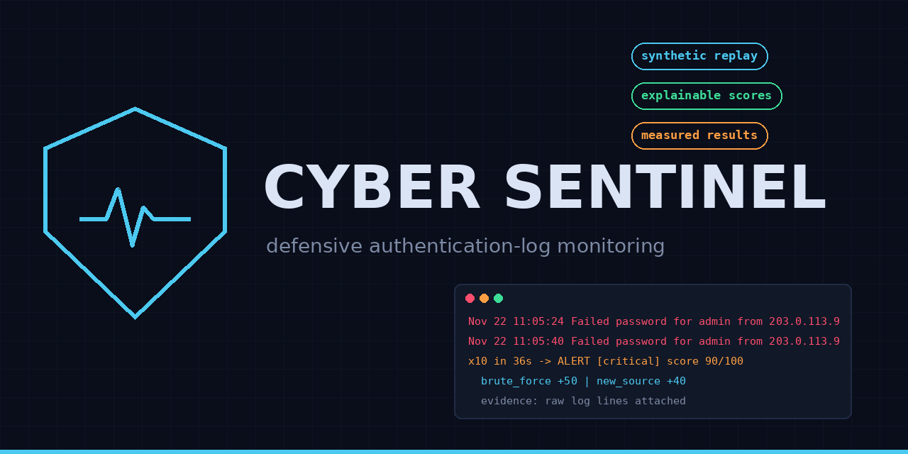
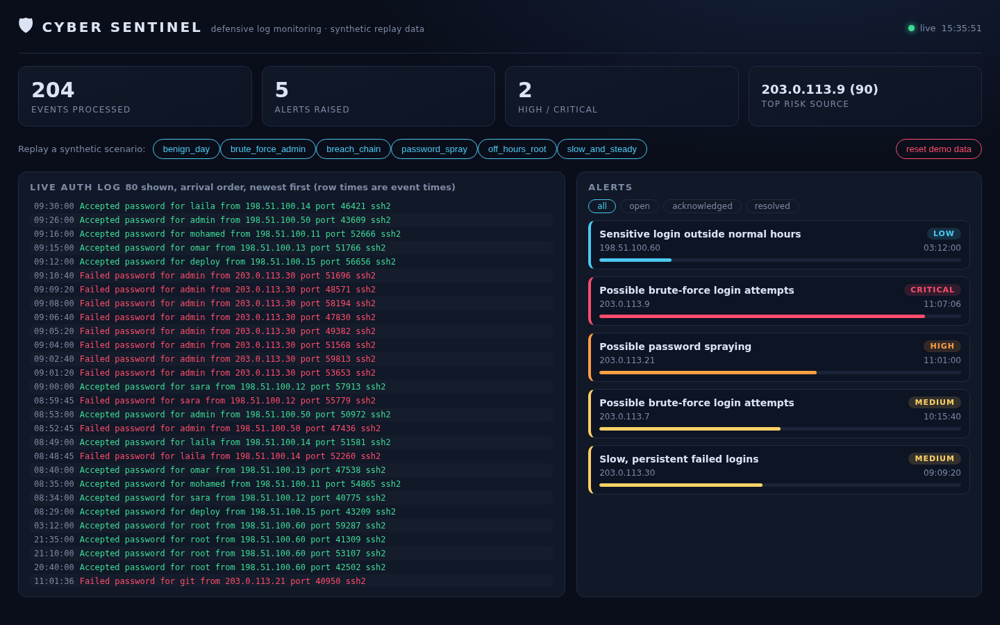
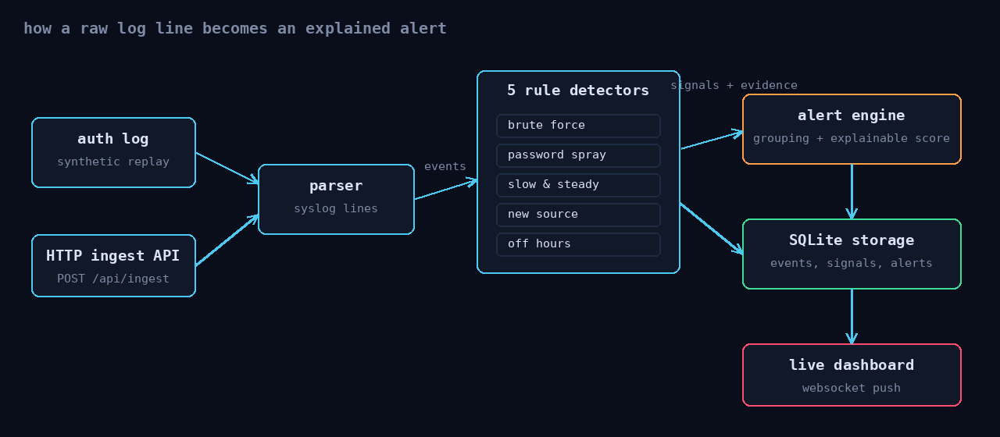
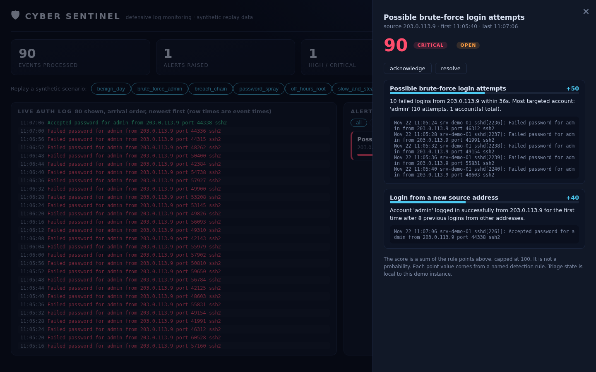

# Cyber Sentinel

Defensive monitoring for authentication logs: it reads sshd-style log lines,
detects suspicious activity with named rules, and raises alerts whose risk
score is fully explained - every point traceable to a rule, with the raw
evidence lines attached.

`python 3.10+` · `54 tests` · `6/6 scenario expectations measured` · `MIT license`

**All demo data is synthetic.** The built-in scenarios use invented users and
synthetic example addresses from ranges reserved for documentation
(`203.0.113.x`, `198.51.100.x`). Nothing here connects to a real server and
no target is ever contacted: the replay tool only generates log lines.



## What it is built to prove

1. **Explainable scores.** A score of 90 means "rules worth 90 points fired",
   with the breakdown shown in the UI. It never claims a probability of attack.
2. **Measured detection.** `eval/report.md` is generated by running the real
   pipeline against scenarios with known answers. Detection, time-to-detect
   and false positives are measured per scenario, not asserted.
3. **Evidence-first alerts.** Every alert keeps the raw log lines that caused
   it, so a reviewer can verify the claim instead of trusting a color.



## Screenshots

The alert detail shows where every point came from and the exact log lines
behind each rule:



## Quickstart

Requires Python 3.10+.

```bash
python3 -m venv .venv
source .venv/bin/activate        # Windows: .venv\Scripts\activate
pip install -r requirements.txt
PYTHONPATH=src python -m uvicorn cyber_sentinel.app:app --port 8791
# Windows PowerShell: $env:PYTHONPATH="src"; python -m uvicorn cyber_sentinel.app:app --port 8791
```

Open http://127.0.0.1:8791 and press a scenario button (for example
`breach_chain`) to watch a synthetic attack unfold live and get caught.

With Docker instead:

```bash
docker compose up --build
```

(Docker/compose configuration is provided for convenience; it has not yet
been built on a Docker host - the verified path is the venv install above,
which the clean-install check runs from the released ZIP.)

### Replay from the command line

```bash
PYTHONPATH=src python -m cyber_sentinel.replay --list
PYTHONPATH=src python -m cyber_sentinel.replay --scenario password_spray --speed 30
PYTHONPATH=src python -m cyber_sentinel.replay --scenario breach_chain --stdout   # raw lines, pipe anywhere
```

### Run the tests and the measured evaluation

```bash
pip install -r requirements-dev.txt
PYTHONPATH=src python -m pytest tests/ -q
PYTHONPATH=src python -m cyber_sentinel.eval_runner    # rewrites eval/report.md + report.json
```

## How detection works

Each event (one parsed log line) flows through five stateful rule detectors:

| Detector | Fires when | Base points | ATT&CK mapping |
|---|---|---|---|
| `brute_force` | >= 10 failed logins from one IP within 5 minutes | 35 (+2/extra failure, cap +20; +15 sensitive) | T1110 Brute Force |
| `password_spray` | one IP fails against >= 5 distinct accounts within 5 minutes | 45 (+3/extra account, cap +24; +15 sensitive) | T1110.003 Password Spraying |
| `slow_brute` | >= 6 failures from one IP within 15 minutes, spread over >= 7 minutes (paced under the burst window) | 30 (+15 sensitive) | T1110 Brute Force |
| `new_source` | an account logs in from an address it never used (after a baseline of 3 known logins) | 25 (+15 sensitive) | T1078 Valid Accounts |
| `off_hours` | a sensitive account (`root`, `admin`, `administrator`) logs in outside 07:00-22:00 | 20 | contextual rule, no direct ATT&CK technique |

Signals blaming the same source IP within 15 minutes join **one alert**. The
alert score is the strongest contribution of each detector, summed and capped
at 100, so an escalating attack grows one alert instead of flooding the feed.
Severity bands: 1-29 low, 30-59 medium, 60-84 high, 85-100 critical.

All thresholds live in `src/cyber_sentinel/config.py` and are injectable.

## Measured results

*Time to detect* = first attack log line -> first expected signal firing. A
signal's explanation quotes its own internal window, which can be shorter
(the detector needs several lines before it has enough to fire).

Current `eval/report.md`, produced by the evaluation harness on this machine:

| Scenario | Lines | Alerts | Detectors fired | Max score | Time to detect | False positives | Result |
|---|---|---|---|---|---|---|---|
| benign_day | 28 | 0 | none | 0 | - | none | PASS |
| brute_force_admin | 59 | 1 | brute_force | 50 | 36s | none | PASS |
| breach_chain | 62 | 1 | brute_force, new_source | 90 | 36s | none | PASS |
| password_spray | 28 | 1 | password_spray | 60 | 48s | none | PASS |
| off_hours_root | 4 | 1 | off_hours | 20 | 0s | none | PASS |
| slow_and_steady | 23 | 1 | slow_brute | 45 | 480s | none | PASS |

How to read the table: PASS means the scenario met its declared expectation.
For `slow_and_steady` the expectation includes that the *burst* detector
stays quiet (the attack is paced to evade it) while the long-horizon detector
catches it, so 480s to detect is the honest cost of patience, not a bug. The
benign sample is 28 lines: it shows these rules stayed quiet on this sample,
not a measured general false-positive rate.

Test suite: 54 tests (parser, each detector's thresholds, windows and span
rules, scoring bands, alert grouping/escalation, alert triage transitions and
filtering, restart-state rebuild, window/cooldown/span boundaries,
out-of-order and future-dated input, cross-run alert grouping, ATT&CK
mapping, demo reset, end-to-end API, evaluation harness).

## What changed in 1.0.0

- **Low-and-slow detection.** A fifth detector (`slow_brute`) watches a
  15-minute horizon and fires only when failures are spread over at least
  7 minutes, so paced attacks that dodge the 5-minute burst window are now
  caught, without double-reporting fast bursts. The `slow_and_steady`
  scenario moved from a documented miss to a measured detection (480s to
  detect). If an attack is slower than the horizon or smaller than 6
  failures, it is still missed; see the limitations list.
- **ATT&CK mapping.** Each detector names its MITRE ATT&CK technique
  (verified against attack.mitre.org); `off_hours` honestly has none.
- **Publication polish.** Cover, architecture diagram, screenshots, MIT
  license.

## What changed in 0.3.0

- **Alert triage.** Each alert moves through a simple analyst workflow:
  `open -> acknowledged -> resolved` (reopen allowed), from the dashboard or
  `POST /api/alerts/{id}/status`. The alert list filters by status and open
  dashboards update live. Triage state is local to this demo instance - there
  is no auth and no shared SOC backend. Reopen policy: NEW detection activity
  on an acknowledged or resolved alert automatically returns it to `open`,
  so fresh activity never disappears from the open queue; triaging again is
  the way to quiet it.
- **Live feed ordering.** The dashboard feed is arrival order (newest
  arrivals first), exactly what a live tail shows; the row timestamps are
  the event times inside the log lines, which can be out of order when old
  lines are backfilled. Detection windows use event times, not arrival
  order.

## What changed in 0.2.0

- **Detector memory survives a restart.** On startup the pipeline rebuilds
  sliding windows, known user/address baselines and cooldowns from the
  events already stored (most recent 200,000 lines), so an attack spanning a
  restart is still caught and re-ingesting an old log does not duplicate
  alerts. Verified with a real process kill/restart, not only unit tests.
- **Out-of-order lines count correctly.** Detection windows are kept sorted
  and pruned against the newest timestamp seen, so backfilled or batched
  lines behave like ordered ones; ancient lines cannot inflate a window.
- **Predictable replays.** An explicit `reset demo data` button (and
  `POST /api/demo/reset`) wipes all stored synthetic data and resets every
  detector, so repeating a scenario gives the same result as a fresh run.
  It asks for confirmation and is labeled destructive.

## Upgrading from an earlier version

Two safe options; your demo data is never touched silently:

1. **Fresh demo (recommended):** extract the new version into a NEW empty
   folder and follow Quickstart. It starts with an empty synthetic database
   and leaves your old folder untouched.
2. **Keep your existing demo history:** copy `data/sentinel.db` from your
   old folder into the new folder's `data/` before starting (or extract over
   the old folder). The database schema is unchanged since 0.1.0, so
   existing alerts stay (including their triage status); on startup the new
   version rebuilds detector memory from your stored events and detection
   continues where it left off. Carryover was verified against databases
   created by the released 0.1.0 and 0.2.0 packages.

## Known limitations (honest list)

- **Very patient attacks still evade.** `slow_brute` needs 6 failures from
  one source inside 15 minutes, spread over at least 7 minutes. An attack
  slower than that horizon, smaller than 6 failures, or rotated across many
  sources is still missed. Detection here is a floor, not a ceiling.
- Single-host sshd logs only; no Windows event logs, web logs, or agents yet.
- Detector memory is rebuilt from stored events at startup, bounded to the
  most recent 200,000 lines. Older history beyond that bound is not relearned
  (events and alerts themselves are never lost).
- Detectors trust the timestamps inside log lines, never the wall clock. A
  line dated far in the future shifts the detection window forward (older
  lines age out) until lines at the new timeframe fill it again; garbage
  timestamps in, garbage windows out.
- Replaying one attack scenario again within 15 minutes continues the SAME
  alert (incidents are grouped by source address). Use `reset demo data`
  for a clean slate before re-demoing.
- Alert grouping memory is per session: after a restart, NEW activity from
  a source that already has an alert opens a NEW alert instead of
  continuing the old one. The old alert keeps its triage status and the new
  one starts in the open queue, so activity is never silently dropped; the
  cost is one split incident across the restart boundary.
- Syslog timestamps carry no year; the parser uses a configured year.
- The dashboard is deliberately dependency-free (no React build) so it runs
  with no build step. The API is shaped so a React front end can
  replace `static/` later without backend changes.
- No ML. The word "AI" is not used anywhere in this project's claims, on
  purpose. If an ML anomaly layer is ever added, it ships with measured
  precision/recall or not at all.

## Roadmap

- Notification webhooks for alert triage
- More sources: web access logs, Windows events, multi-host agents
- ML anomaly layer, published precision/recall or it does not ship

Scope note: this project is detection-only. It raises and explains alerts;
it does not block, quarantine, or scan files, and it has no antivirus or
malware-scanning features.

## Project structure

```
src/cyber_sentinel/
  ingestion.py    syslog/sshd line parser (skips what it cannot classify)
  detectors/      brute_force, password_spray, slow_brute, new_source, off_hours
  scoring.py      every point weight, in one documented place
  alerts.py       signal grouping + explainable score assembly
  storage.py      SQLite (stdlib sqlite3, WAL)
  pipeline.py     line in -> events -> signals -> persisted alerts
  scenarios.py    synthetic scenarios with known ground truth
  eval_runner.py  measured detection report (gates CI)
  replay.py       CLI scenario player
  app.py          FastAPI: REST + websocket + static dashboard
  static/         dependency-free live dashboard
tests/            54 tests
eval/             generated measured reports
docs/             cover, architecture diagram, screenshots
data/sample_data/ example synthetic log file
```

## License

MIT - see [LICENSE](LICENSE).
