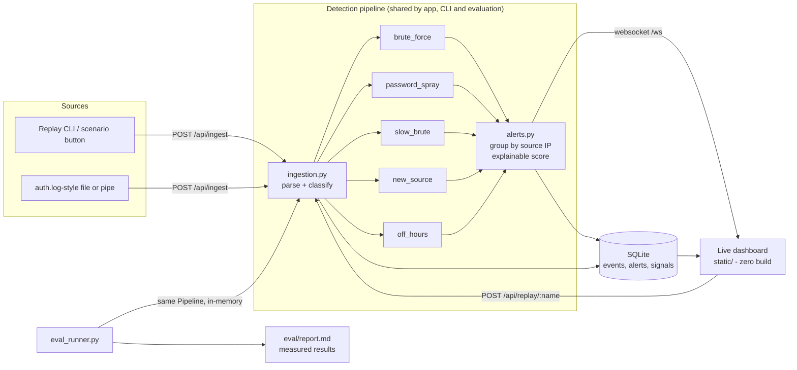

# Architecture

## Design decisions worth explaining

- **One pipeline, three front doors.** The HTTP app, the replay CLI and the
  evaluation harness all drive the same `Pipeline` object, so measured
  results describe the exact code the demo runs.
- **Rules before ML.** Deterministic detectors with injectable thresholds are
  testable and explainable. An ML layer is on the roadmap and ships only with
  published precision/recall on labeled scenarios.
- **Escalation over noise.** A detector fires at most once per key per
  cooldown; signals on one source merge into a single alert whose score grows
  with each new *kind* of evidence.
- **Stdlib SQLite.** Three tables, no ORM, WAL mode so the dashboard can read
  while ingestion writes.
- **Zero-build UI.** Vanilla JS over REST + websocket. A React front end can
  replace `static/` without touching the API.
